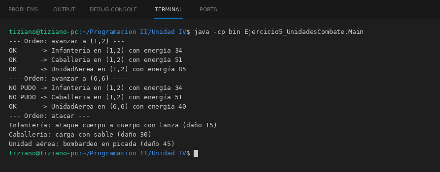

# UnidadCombate

Programación II - Unidad 4 - Ejercicio 5

## Consigna
Mover y atacar con distintas unidades de un juego de estrategia usando la misma orden.

## Lógica
- Clase abstracta `UnidadCombate` (posicionX, posicionY, energia) con `moverse(int, int)` y `atacar()` abstractos; la posición y la energía solo cambian por métodos protegidos.
- `Infanteria` (alcance 3, 2 de energía por casilla), `Caballeria` (alcance 8, 3 por casilla) y `UnidadAerea` (sin límite de terreno, 5 por casilla) implementan sus propias restricciones y devuelven `false` si no pueden moverse.
- `ComandoGeneral` recibe una `List<UnidadCombate>` y ordena movimientos y ataques de forma polimórfica.
- `Main`: dos órdenes de movimiento (algunas unidades no llegan) y un ataque general.

## Ejecución

